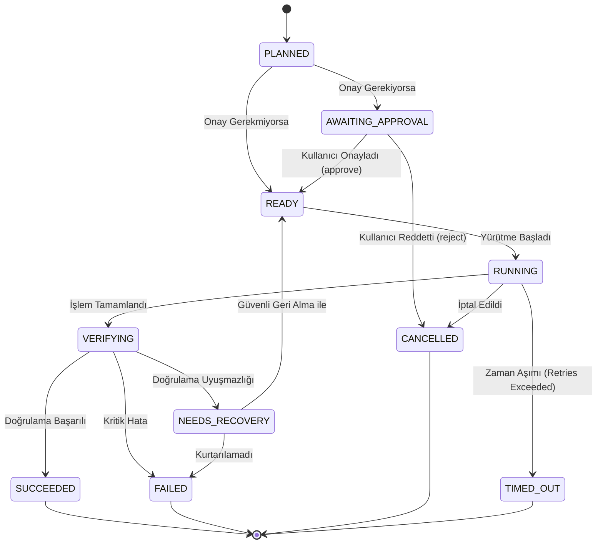

# FL Studio AI Assistant — Eylem Protokolü ve Güvenlik Kuralları (Action Protocol)

**Belge Sürümü:** 0.3.0 (Phase 3)  
**Hedef:** Güvenli, izlenebilir, onay kontrollü ve doğrulanabilir eylem yürütme standardı.

---

## 1. Temel Güvenlik İlkeleri (Mandatory Safety Rules)

1. **Kabuk (Shell) Yürütme Yasağı:** Model çıktıları veya eylem tanımları doğrudan rastgele kabuk komutları çalıştıramaz. Tüm eylemler strictly-typed `ActionType` beyaz listesi (allowlist) üzerinden doğrulanır.
2. **Kimlik ve Durum İzlenebilirliği:** Her eylem benzersiz bir `action_id`, ait olduğu `task_id` ve durum geçmişi ile SQLite veritabanına kalıcı olarak kaydedilir.
3. **Onay Zorunluluğu (Approval Gating):** `DESTRUCTIVE` veya Güvenli Modda `HIGH` riskli eylemler kullanıcı açık onay vermedikçe (`approve_action`) `AWAITING_APPROVAL` durumunda tutulur ve asla çalıştırılamaz.
4. **Kesin Doğrulama (Strict Verification):** Bir komutun gönderilmiş olması "başarılı" kabul edilmesi için yeterli değildir. DAW durumundan veya sistemden geri okuma yapılarak doğrulama yapılır; doğrulanamayan eylemler `UNVERIFIED` veya `FAILED` kalır.
5. **Güvenli İptal (Cancellation):** Kullanıcı iptal ettiğinde çalışan işlemler kesilir ve planlanan bekleyen eylemler iptal edilir.
6. **Zaman Aşımı ve Sınırlı Yeniden Deneme (Timeouts & Bounded Retries):** Her eylem tanımlı bir zaman aşımı penceresine (`timeout_seconds`) ve sınırlandırılmış yeniden deneme sayısına (`max_retries`) sahiptir.

---

## 2. Eylem Beyaz Listesi (Action Allowlist)

Desteklenen eylemler `ActionType` enum'u ile sınırlıdır:

| Eylem Tipi | Kategori | Risk Düzeyi | Varsayılan Rota |
|---|---|---|---|
| `READ_TEMPO` | Proje Okuma | LOW | `FL_MCP` |
| `READ_PLAY_STATE` | Transport Okuma | LOW | `FL_MCP` |
| `READ_PROJECT_STATE` | Proje Özeti | LOW | `FL_MCP` |
| `READ_CHANNELS` | Kanal Listesi | LOW | `FL_MCP` |
| `READ_MIXER_TRACKS` | Mikser Listesi | LOW | `FL_MCP` |
| `READ_PATTERNS` | Pattern Listesi | LOW | `FL_MCP` |
| `SET_TEMPO` | Değer Değiştirme | MEDIUM | `FL_MCP` (Fallback: `GUI_AUTOMATION`) |
| `SET_PLAY_STATE` | Transport Kontrolü | MEDIUM | `FL_MCP` |
| `CREATE_MIDI_PATTERN` | Müzik Üretimi | MEDIUM | `FL_MCP` |
| `CREATE_DRUM_PATTERN` | Ritim Üretimi | MEDIUM | `FL_MCP` |
| `SET_CHANNEL_VOLUME` / `PAN` | Kanal Ayarı | MEDIUM | `FL_MCP` |
| `SET_MIXER_VOLUME` / `PAN` | Mikser Ayarı | MEDIUM | `FL_MCP` |
| `SET_MIXER_MUTE` / `SOLO` | Mikser Kontrolü | MEDIUM | `FL_MCP` |
| `OPEN_PLUGIN_WINDOW` | Görsel Arayüz | MEDIUM | `GUI_AUTOMATION` |
| `LOAD_PLUGIN_PRESET` | Preset Yükleme | MEDIUM | `GUI_AUTOMATION` |
| `CAPTURE_SCREENSHOT` | Ekran Denetimi | LOW | `GUI_AUTOMATION` |
| `SCAN_SAMPLE_DIRECTORY` | Dosya İnceleme | LOW | `LOCAL_SERVICE` |
| `ANALYZE_AUDIO_FILE` | Audio Analizi | LOW | `LOCAL_SERVICE` |
| `CREATE_PROJECT_CHECKPOINT`| Güvenlik/Yedek | MEDIUM | `LOCAL_SERVICE` |
| `RESTORE_PROJECT_CHECKPOINT`| Kurtarma | HIGH / DESTRUCTIVE | `LOCAL_SERVICE` |
| `EXPORT_AUDIO` | Dışa Aktarma | HIGH | `GUI_AUTOMATION` |

---

## 3. Eylem Yaşam Döngüsü (Action Lifecycle)

### Durum Açıklamaları
- **`PLANNED`:** Eylem tasarlandı ancak henüz onay ve rota kontrollerinden geçmedi.
- **`AWAITING_APPROVAL`:** Riskli eylemler bu durumda bekletilir; onay gelmeden asla çalıştırılamaz.
- **`READY`:** Eylem onaylandı, rotası belirlendi ve yürütmeye hazır.
- **`RUNNING`:** Eylem arka planda ilgili adaptör (FL MCP, HCU vb.) üzerinden yürütülüyor.
- **`VERIFYING`:** Komut gönderildi; sonuç durumu (örneğin BPM geri okuması, dosya boyutu kontrolü) inceleniyor.
- **`SUCCEEDED`:** Eylemin sonucu başarıyla doğrulandı.
- **`FAILED`:** Eylem başarısız oldu ve kurtarılamadı.
- **`NEEDS_RECOVERY`:** Doğrulama uyumsuzluğu tespit edildi; kurtarma planı (checkpoint geri yükleme vb.) gerektiriyor.
- **`CANCELLED`:** Kullanıcı tarafından durduruldu.
- **`TIMED_OUT`:** Bounded retry kotası aşıldı ve zaman aşımına uğradı.

---

## 4. Risk Seviyeleri ve İzinler

- **`LOW` (Düşük):** Yalnızca okuma, proje durumunu inceleme, ekran görüntüsü alma. Kullanıcı onayı gerekmez.
- **`MEDIUM` (Orta):** Geri alınabilir, tahribatsız işlemler (boş kanala melodi yazma, tempo değiştirme, seviye ayarlama).
- **`HIGH` (Yüksek):** Ses render alma, proje dışına dosya yazma. Güvenli modda kullanıcı onayı zorunludur.
- **`DESTRUCTIVE` (Yıkıcı):** Var olan dosyaların veya pattern'lerin üzerine yazma, silme, projeyi sıfırlama. **Her zaman zorunlu kullanıcı onayı gerektirir.**

---

## 5. Doğrulama Motoru (Verification Engine)

| Eylem Tipi | Doğrulama Yöntemi | Başarı Kriteri |
|---|---|---|
| `SET_TEMPO` | FL Studio'dan güncel BPM'i geri okuma | `abs(okunan - istenen) <= tolerance` (varsayılan: 0.05) |
| `SET_MIXER_*` | Mikser kanal parametresini geri okuma | `abs(okunan - istenen) <= 0.05` |
| `CREATE_*_PATTERN` | Kanalın nota ve grid verisini okuma | Not sayısı > 0 ve kanal boş değil |
| `EXPORT_AUDIO` | Çıktı dosyasını diskte kontrol etme | Dosya var ve boyutu >= 1 KB (geçerli audio başlığı) |
| *Okuma Eylemleri* | Dönen veri yapısı kontrolü | Veri `None` değil ve geçerli |
| *Desteksiz Eylemler*| Geri okunamayan komutlar | `verified = False` (asla sahte doğrulama yapılmaz) |

---

## 6. Kalıcılık (SQLite Persistence)

Veriler yerel SQLite veritabanında tutulur:
- **`tasks` tablosu:** `task_id`, `prompt`, `status`, `is_mock`, `created_at`, `completed_at`, `result_summary`, `error`
- **`actions` tablosu:** `action_id`, `task_id`, `action_type`, `target`, `parameters_json`, `execution_route`, `risk_level`, `requires_approval`, `status`, `timeout_seconds`, `retry_count`, `created_at`, `started_at`, `finished_at`, `verified`, `verification_detail`, `error`
- **`checkpoints` tablosu:** `checkpoint_id`, `task_id`, `name`, `state_json`, `created_at`

