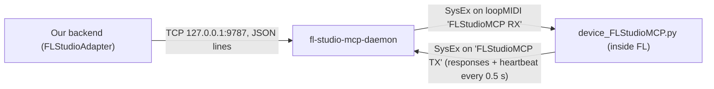

# FL Studio Integration

## Selected integration

| Item | Value |
|---|---|
| Project | [rosasynthesiz/flstudio-mcp](https://github.com/rosasynthesiz/flstudio-mcp) (MIT) |
| Pinned commit | `30ad1121fb511c7524d3b38261506a2e72a96595` (2026-11-04), see `configs/external-pins.json` |
| Local modifications | none |
| Tested FL Studio | FL Studio 2025 v25.1.6.4997 |

## How it works



* We do **not** use the MCP stdio server. Our backend talks to the daemon through
  `fl_studio_mcp.connection.TCPBridge`, imported from the pinned repo.
* SysEx payloads above ~1.5 KB are dropped, so list commands are paginated.
  The adapter uses `fetch_all_pages`.
* Heartbeat older than 3 s → FL Studio counts as not running.

## Adapter

`backend/app/integrations/fl_studio/adapter.py` — `FLStudioAdapter`

| Method | Controller command | Kind |
|---|---|---|
| `connect()` | daemon `health` op | probe. Reports `connected=False` if the daemon is down |
| `check_health()` / `ping()` | `ping` | read |
| `get_tempo()` | `get_tempo` → `{bpm, raw}` | read |
| `get_project_state()` | `get_project_state` | read |
| `get_play_state()` | `get_play_state` | read |
| `get_channels()` / `get_patterns()` / `get_mixer_tracks()` | paginated lists | read |
| `set_tempo_verified(bpm)` | `set_tempo` + `get_tempo` read-back | **write**, verified |

`get_project_state` does **not** report project title or time signature. These stay
*unknown* in our model and are never guessed.

## Setup (one time)

1. **loopMIDI**: remove default-named ports, then create two ports named exactly
   `FLStudioMCP RX` and `FLStudioMCP TX`. Keep loopMIDI running.
2. **Installer** (copies the controller into `Documents\Image-Line\FL Studio\Settings\Hardware\FLStudioMCP\`
   and creates `external\flstudio-mcp\.venv`):
   ```powershell
   cd external\flstudio-mcp
   $env:FLMCP_EXTRAS="none"; cmd /c scripts\install_windows.bat
   ```
3. **FL Studio → Options → MIDI Settings**
   * Input `FLStudioMCP RX`: Enable, Controller type **FLStudioMCP**, Port e.g. `10`.
   * Output `FLStudioMCP TX`: set the **same** Port (`10`). Leave "Send master sync" off.
   * View → Script output must show `[FLStudioMCP] Ready`.
4. **Daemon** (keep the window open): `external\flstudio-mcp\scripts\start_daemon.bat`
5. Note writing (Phase 4+): once per session, Piano roll → Tools → Scripting → MCP → *MCP Apply*.

## Verification

```powershell
cd backend
.venv\Scripts\python scripts\poc_fl.py            # read-only
.venv\Scripts\python scripts\poc_fl.py --write    # BPM 133 → verify → restore (needs approval)
.venv\Scripts\python -m pytest -m real_fl         # real tests (write test needs FL_ALLOW_WRITE=1)
```

## Known limitations (from upstream + our tests)

* Plugin loading, audio file loading and rendering cannot be done through the API. They must use GUI automation.
* Note writing needs the per-session *MCP Apply* arming step and a run-last-script keyboard trigger.
* Some plugin parameters ignore writes or snap to steps. Upstream reports `verified:false`.
* The agent's sandboxed shell cannot open local TCP sockets (WinError 10013). Real FL tests must run
  in the normal user session (later, this is the desktop app's backend process).

